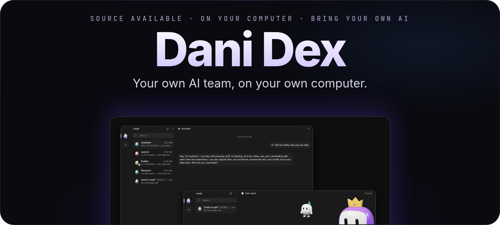
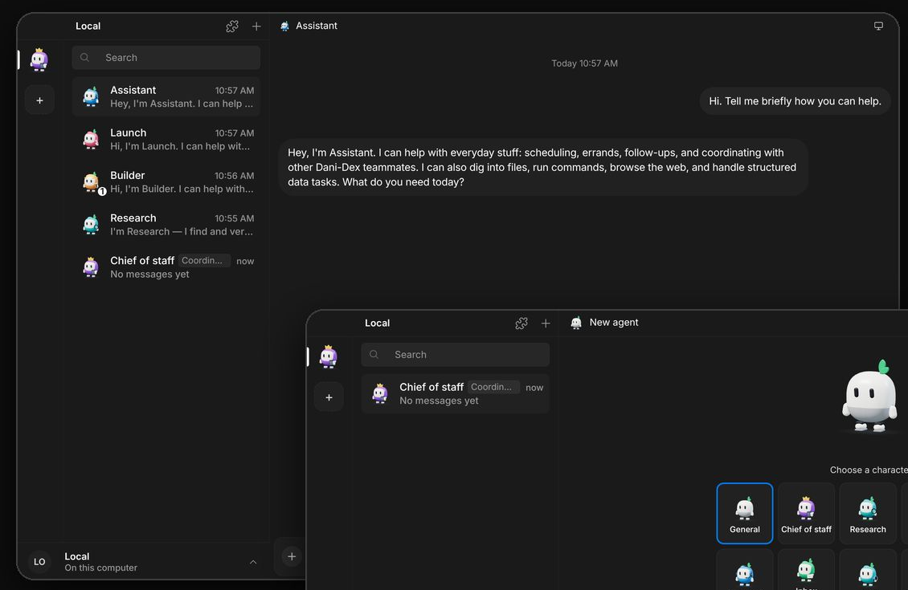
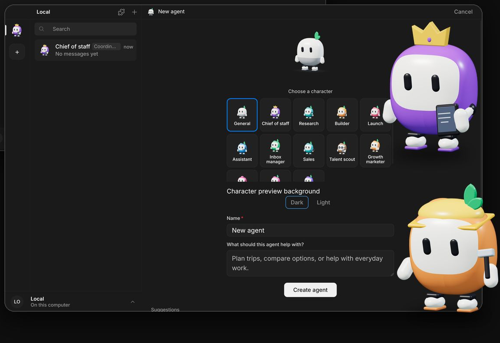
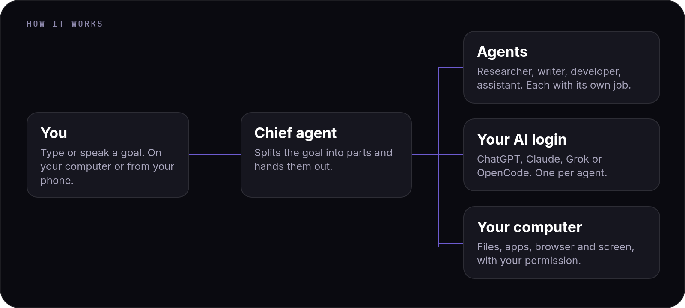

 
 

<a href="https://dl.dani.danlab.dev/desktop/Dani-Dex-mac-arm64.dmg"><picture><source media="(prefers-color-scheme: dark)" srcset="docs/assets/readme/btn-mac-dark.png"><source media="(prefers-color-scheme: light)" srcset="docs/assets/readme/btn-mac-light.png"></picture></a>&nbsp;
<a href="https://dl.dani.danlab.dev/desktop/Dani-Dex-win-x64.exe"><picture><source media="(prefers-color-scheme: dark)" srcset="docs/assets/readme/btn-win-dark.png"><source media="(prefers-color-scheme: light)" srcset="docs/assets/readme/btn-win-light.png"></picture></a>&nbsp;
<a href="https://dl.dani.danlab.dev/android/dani-dex.apk"><picture><source media="(prefers-color-scheme: dark)" srcset="docs/assets/readme/btn-and-dark.png"><source media="(prefers-color-scheme: light)" srcset="docs/assets/readme/btn-and-light.png"></picture></a>

Also: [Mac (Intel)](https://dl.dani.danlab.dev/desktop/Dani-Dex-mac-x64.dmg) · [All downloads](https://dani.danlab.dev/#download) · Linux build is planned

 

**[Features](#what-it-does)** &nbsp;·&nbsp; **[How it works](#how-it-works)** &nbsp;·&nbsp; **[Install](#install)** &nbsp;·&nbsp; **[Privacy](#privacy)** &nbsp;·&nbsp; **[Contribute](#status-and-contributing)**

 

## One chatbot is the wrong shape for real work.

Dani Dex is a team of AI agents that works on your own computer. Tell it what you need in plain words. Its agents plan the work, use your apps, files and browser, talk to each other, and come back with the job done.

**Give each agent a job. Watch them work. Approve what matters.**

- **Works where your work is.** Your files, apps and logins stay on your computer. Nothing has to be uploaded to a cloud machine first.
- **Bring the AI you already pay for.** Use ChatGPT (Codex), Claude, Grok or OpenCode, and pick a different one for each agent. OpenCode's free models work with no account at all.
- **No Dani Dex account to start.** Download it, open it, begin. Your phone and your computer can share one Google sign-in when you want them linked.

 

## What it does

### A team, not one chatbot

Give each agent a job: researcher, writer, developer, assistant. The Chief agent splits a big goal into parts, hands them out, and puts the pieces back together.

### Hand off the busywork

"Sort these receipts into a spreadsheet." "Rename and file every PDF in Downloads." "Turn my meeting notes into a to-do list." The agent does it on your computer, with your files, and shows you the result.

### Make an agent in a minute

Pick a character, name the agent, say what it should help with, and it is on your team. Each agent can use a different AI.

### And the rest

<table>
<tr>
<td width="28%"><b>Research and write</b></td>
<td>Ask for a market scan, a competitor comparison, a launch plan or a first draft. Agents read the web in their own browser, collect sources and hand back a finished document.</td>
</tr>
<tr>
<td width="28%"><b>Build things</b></td>
<td>Agents write and run code, fix bugs, make websites and test their own work, using the coding tools developers already trust.</td>
</tr>
<tr>
<td width="28%"><b>Use your computer like you do</b></td>
<td>With your permission, agents can see the screen and click and type in your apps (Computer Use), so they can work in software that has no API.</td>
</tr>
<tr>
<td width="28%"><b>Talk instead of type</b></td>
<td>Speak a request and Dani Dex turns it into text on your computer.</td>
</tr>
<tr>
<td width="28%"><b>Updates itself</b></td>
<td>From version 0.17.2 on, Dani Dex offers each new version inside the app and restarts into it.</td>
</tr>
</table>

<b>How it compares</b>

 

Checked in September 2026 against public pages about each product.

| | Dani Dex | [Grok Bot](https://x.ai/news/introducing-grok-bot) | [Instinct](https://instinct.com/) |
| --- | --- | --- | --- |
| Where the agent works | Your own computer | A persistent cloud computer, shared by all your bots ([xAI docs](https://docs.x.ai/grok-bot/overview)) | Connected to your email, calendar and messaging, and you talk to it over iMessage and WhatsApp ([WIRED](https://www.wired.com/story/i-finally-found-an-ai-agent-worth-the-risk/)) |
| Runs on your laptop | Yes | No, its bots run on the cloud computer ([xAI docs](https://docs.x.ai/grok-bot/overview)) | Connects to your apps and devices ([instinct.com](https://instinct.com/)) |
| Getting in | Free download, no Dani Dex account | Through [x.ai/bot](https://x.ai/bot) | Invite-only when WIRED reviewed it |

**Where Dani Dex is different from Grok Bot:** Grok Bot's bots work on a cloud computer that xAI runs. Dani Dex's agents work on your own computer, next to the files and desktop apps you already have, and they can run on a ChatGPT, Claude, Grok or OpenCode login.

 

## How it works

You give a goal. The Chief agent splits it into parts and hands them to agents. Each agent runs on the AI login you chose for it and works on your computer, with your permission.

<b>Our mission</b>

 

We are building a **self-improving personal assistant**: one that learns how you work, gets better at your tasks each time it does them, and takes on more of your work as it earns your trust. It should run where your life already is, with the AI you choose, and stay yours.

Dani Dex is the first step: a team of agents on your computer that can already do real work.

 

## Install

**Download an installer** with the buttons at the top. Downloads are on the [Dani download page](https://dani.danlab.dev/#download), where each file is listed with its checksum.

1. Click the download button for your computer.
2. Install it:
   - **Mac:** open the file and drag Dani Dex to Applications. The first time, Control-click Dani Dex in Applications and choose **Open**. If macOS still blocks it, go to **System Settings > Privacy & Security** and click **Open Anyway**. Pick the Apple silicon or Intel file to match your Mac.
   - **Windows:** run the installer. If a blue SmartScreen window appears, click **More info**, then **Run anyway**.
   - **Android:** open the APK on your phone and allow installs from your browser when asked. Sign in with the same Google account as on your computer to pair them.
   - **Linux:** a build is planned. The AppImage will follow the same pattern; see the [Linux notes](docs/DEVELOPMENT.md#linux-launch-details).
3. Open Dani Dex and pick an AI. OpenCode's free models work right away. For ChatGPT, Claude or Grok, click Connect and sign in with that service.
4. Tell the Chief agent what you want, like "Turn these release notes into a launch plan."

**You'll need** macOS 13 or newer, Windows 10 or newer (x64), or a recent Android phone. The apps are not code-signed yet, which is why Mac and Windows show a warning the first time.

**Or build one from source** with the steps in the [development guide](docs/DEVELOPMENT.md). It covers commands, architecture, local data paths, releases and shared Mac hosts.

> [!WARNING]
> Dani Dex is an early preview. Agents can read and change files, run programs, use the internet and control the browser on your computer without asking before each step. Give them tasks you trust, keep backups, and read [SECURITY.md](SECURITY.md).

 

## Privacy

Dani Dex keeps your agents, chats and files on your computer. The AI provider you pick (OpenAI, Anthropic, xAI or OpenCode) receives what the agent sends it, and web pages the agent visits see that visit. Dani Dex never copies your provider passwords. Details are in [PRIVACY.md](PRIVACY.md).

Need help? See [Troubleshooting](docs/TROUBLESHOOTING.md) or [SUPPORT.md](SUPPORT.md).

 

## Status and contributing

**Early but real.** The loop works end to end: you ask, agents plan, use your computer, and report back. Expect rough edges: the apps are unsigned, Linux is not built yet, and mobile pairing is still new.

Contributions welcome. See [CONTRIBUTING.md](CONTRIBUTING.md). Community behavior is governed by the [Code of Conduct](CODE_OF_CONDUCT.md). For developers: [development guide](docs/DEVELOPMENT.md), [ARCHITECTURE.md](docs/ARCHITECTURE.md), [RELEASING.md](docs/RELEASING.md) and [the changelog](CHANGELOG.md).

 

## License

See [LICENSE](LICENSE). Required upstream attribution and third-party notices are in [NOTICE](NOTICE), and they continue to apply.

Dani Dex is an independent source-available project and is not affiliated with, endorsed by, or sponsored by OpenAI. OpenAI, ChatGPT, and Codex are used only to describe compatibility with their respective products and services.
