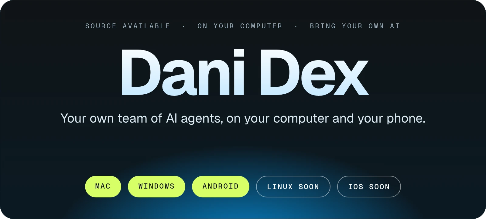
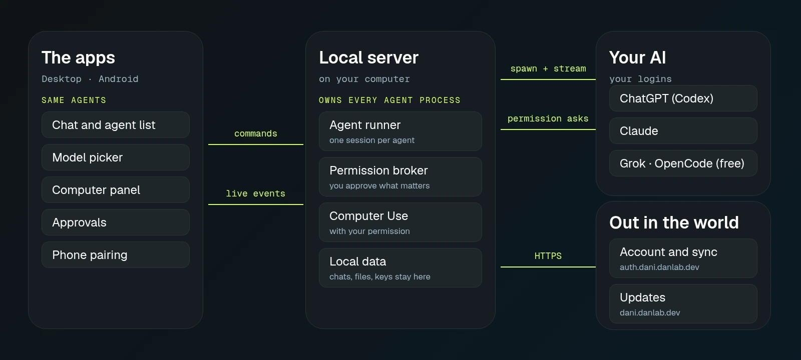

<div align="center">

<a href="https://dl.dani.danlab.dev/latest.json">
  
</a>

<br>
<br>

<a href="https://dl.dani.danlab.dev/desktop/Dani-Dex-mac-arm64.dmg"><picture><source media="(prefers-color-scheme: dark)" srcset="docs/assets/readme/btn-mac-dark.png"><source media="(prefers-color-scheme: light)" srcset="docs/assets/readme/btn-mac-light.png"></picture></a>&nbsp;
<a href="https://dl.dani.danlab.dev/desktop/Dani-Dex-win-x64.exe"><picture><source media="(prefers-color-scheme: dark)" srcset="docs/assets/readme/btn-win-dark.png"><source media="(prefers-color-scheme: light)" srcset="docs/assets/readme/btn-win-light.png"></picture></a>&nbsp;
<picture><source media="(prefers-color-scheme: dark)" srcset="docs/assets/readme/btn-lin-dark.png"><source media="(prefers-color-scheme: light)" srcset="docs/assets/readme/btn-lin-light.png"></picture>

<a href="https://dl.dani.danlab.dev/android/dani-dex.apk"><picture><source media="(prefers-color-scheme: dark)" srcset="docs/assets/readme/btn-and-dark.png"><source media="(prefers-color-scheme: light)" srcset="docs/assets/readme/btn-and-light.png"></picture></a>&nbsp;
<picture><source media="(prefers-color-scheme: dark)" srcset="docs/assets/readme/btn-ios-dark.png"><source media="(prefers-color-scheme: light)" srcset="docs/assets/readme/btn-ios-light.png"></picture>

<sub>Also: [Mac (Intel)](https://dl.dani.danlab.dev/desktop/Dani-Dex-mac-x64.dmg) · [Checksums and versions](https://dl.dani.danlab.dev/latest.json) · [All releases](https://github.com/Dan-Labs-Agi/dani-dex/releases)</sub>

<br>

**[What it does](#what-it-does)** &nbsp;·&nbsp; **[How it works](#how-it-works)** &nbsp;·&nbsp; **[Install](#install)** &nbsp;·&nbsp; **[Platforms](#platform-support)** &nbsp;·&nbsp; **[Contribute](#status-and-contributing)**

</div>

<br>

## One chatbot in one box is the wrong shape for agents.

Dani Dex is a team of agents that works on your own computer. Tell it what you need in plain words. Its agents plan the work, use your apps, files and browser, talk to each other, and come back with the job done.

**Give each agent a job. Watch them work. Approve what matters.**

- **Your work stays where it is.** Your files, apps and logins stay on your computer. Nothing is uploaded to a cloud machine first.
- **Your choice of AI.** Use ChatGPT (Codex), Claude, Grok or OpenCode, and pick a different one for each agent. OpenCode's free models work with no account at all.
- **Agents with hands.** With your permission, agents see the screen and click and type in your apps (Computer Use), and read the web in their own browser.

<br>

## What it does

### Hand off the busywork

"Sort these receipts into a spreadsheet." "Rename and file every PDF in Downloads." "Turn my meeting notes into a to-do list." The agent does it on your computer, with your files, and shows you the result.

### Research and write

Ask for a market scan, a competitor comparison, a launch plan or a first draft. Agents read the web, collect sources and hand back a finished document.

### Build things

Agents write and run code, fix bugs, make websites and test their own work, using the coding tools developers already trust.

### A small team, not one chatbot

Give each agent a job: researcher, writer, developer, assistant. The Chief agent splits a big goal into parts, hands them out, and puts the pieces together.

### And the rest

<table>
<tr>
<td width="28%"><b>Computer Use</b></td>
<td>Agents can work in software that has no API. Every use needs your permission.</td>
</tr>
<tr>
<td width="28%"><b>Talk instead of type</b></td>
<td>Speak a request and Dani Dex turns it into text on your computer.</td>
</tr>
<tr>
<td width="28%"><b>Free models, free of accounts</b></td>
<td>No Dani Dex account. Download it, open it, start. No subscription.</td>
</tr>
<tr>
<td width="28%"><b>Updates itself</b></td>
<td>Dani Dex offers each new version inside the app and restarts into it.</td>
</tr>
</table>

<br>

## How it works



The app talks to a local server on your computer. The server runs your agents, keeps their transcripts and keys on your machine, and asks you before anything that matters. The phone app pairs with your computer and works with the same agents.

<details>
<summary><b>Where everything lives</b></summary>

<br>

See [ARCHITECTURE.md](docs/ARCHITECTURE.md) for the layers, and the [development guide](docs/DEVELOPMENT.md) for local data paths.

</details>

<br>

## Install

**Download an installer** with the buttons at the top. Downloads come from `dl.dani.danlab.dev`. The apps are not code-signed yet, so the first launch shows a warning.

- **Mac:** open the file and drag Dani Dex to Applications. The first time, Control-click Dani Dex in Applications and choose **Open**. If macOS still blocks it, go to **System Settings > Privacy & Security** and click **Open Anyway**. Needs macOS 13 or newer.
- **Windows:** run the installer. If a blue SmartScreen window appears, click **More info**, then **Run anyway**.
- **Android:** download the APK and open it. Allow installs from your browser or file manager when Android asks. If Play Protect warns, choose **Install anyway**.
- **Linux and iOS:** coming soon.

Then open Dani Dex and pick an AI. OpenCode's free models work right away. For ChatGPT, Claude or Grok, click Connect and sign in with that service. Tell the Chief agent what you want, like "Turn these release notes into a launch plan."

> [!WARNING]
> Dani Dex is an early preview. Agents can read and change files, run programs, use the internet and control the browser on your computer without asking before each step. Give them tasks you trust, keep backups, and read [SECURITY.md](SECURITY.md).

<details>
<summary><b>Install from a terminal</b></summary>

<br>

macOS, Linux or WSL:

```bash
curl -fsSL https://raw.githubusercontent.com/Dan-Labs-Agi/dani-dex/main/scripts/onboard.sh | bash
```

Windows (PowerShell):

```powershell
irm https://raw.githubusercontent.com/Dan-Labs-Agi/dani-dex/main/scripts/onboard.ps1 | iex
```

The scripts download the current release and check the checksum before they install.

</details>

<details>
<summary><b>Run from source</b></summary>

<br>

Building from source, commands, architecture, local data paths, releases and shared Mac hosts are in the [development guide](docs/DEVELOPMENT.md). See also [RELEASING.md](docs/RELEASING.md) and [the changelog](CHANGELOG.md).

</details>

<br>

## Platform support

| Capability | macOS | Windows | Android | Linux | iOS |
| :-- | :-- | :-- | :-- | :-- | :-- |
| Desktop app with agents | Supported | Supported | n/a | Coming soon | n/a |
| Phone app (pairs with your computer) | n/a | n/a | Supported (APK) | n/a | Coming soon |
| Computer Use | Supported | Supported | n/a | Coming soon | n/a |

macOS 13 or newer (Apple silicon and Intel), Windows 10 or newer (x64), Android 7 or newer (arm64).

<br>

## Privacy

Dani Dex keeps your agents, chats and files on your computer. The AI provider you pick (OpenAI, Anthropic, xAI or OpenCode) receives what the agent sends it, and web pages the agent visits see that visit. Dani Dex never copies your provider passwords. Details are in [PRIVACY.md](PRIVACY.md). Need help? See [Troubleshooting](docs/TROUBLESHOOTING.md) or [SUPPORT.md](SUPPORT.md).

<br>

## Status and contributing

**Early but real.** The loop works end to end: message, agent, reply, tools, approvals, computer use. Expect rough edges. Linux and iOS are still being built.

Contributions welcome. See [CONTRIBUTING.md](CONTRIBUTING.md). Community behavior is governed by the [Code of Conduct](CODE_OF_CONDUCT.md).

<br>

## License

The retained upstream license is in [LICENSE](LICENSE). Required attribution and third-party notices are in [NOTICE](NOTICE).

<sub>Dani Dex is an independent source-available project and is not affiliated with, endorsed by, or sponsored by OpenAI. OpenAI, ChatGPT, and Codex are used only to describe compatibility with their respective products and services.</sub>
